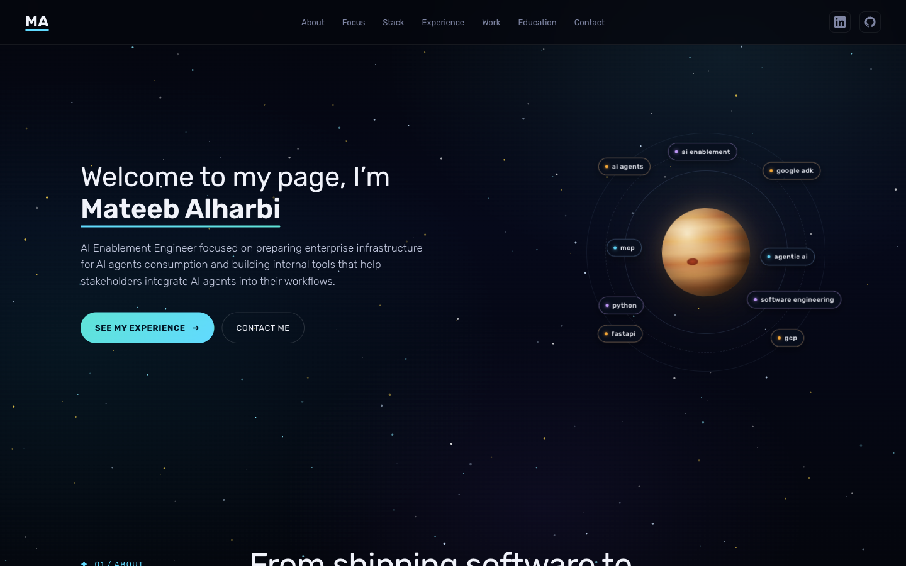
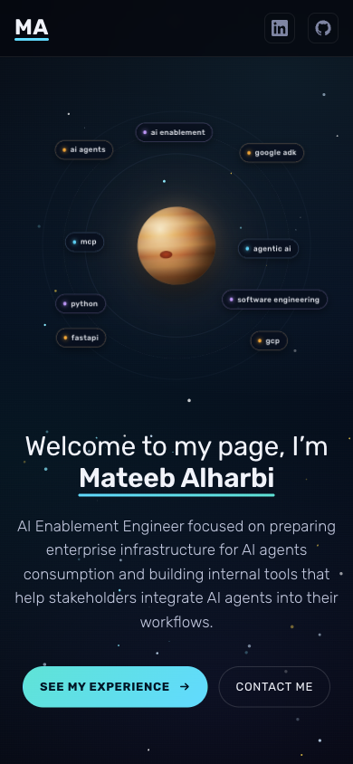

# Portfolio v2

My personal portfolio: who I am, what I focus on, my experience, skills, selected projects and education. It is the second version of my portfolio, rebuilt around my work in AI enablement and agentic AI, with a space theme of a starfield, a planet and skills orbiting it.

**Live site:** [mateeb.com](https://mateeb.com)

## Table of contents

- [Overview](#overview)
  - [Sections](#sections)
  - [Screenshots](#screenshots)
  - [Links](#links)
- [My process](#my-process)
  - [Built with](#built-with)
  - [Project structure](#project-structure)
  - [Run locally](#run-locally)
  - [Deployment](#deployment)
- [Previous version](#previous-version)
- [Author](#author)

## Overview

### Sections

- **Header**: logo, section navigation and links to LinkedIn and GitHub.
- **Hero**: a short introduction, with my top skills orbiting a planet.
- **About**: my path from software engineering to AI enablement, in three steps, and what I bring.
- **Focus**: the three areas I work on: agent platforms, secure MCP infrastructure and AI enablement.
- **Stack**: my skills, grouped by area.
- **Experience**: every role with its responsibilities and achievements.
- **Work**: selected frontend projects, each with a screenshot, its stack, a live site link and a code link.
- **Education**: my degree and executive training.
- **Contact**: email and LinkedIn, plus a form that sends a message straight to my inbox.
- **Footer**: logo, social links and rights text.

The layout is responsive from phone to desktop, and animations are switched off for visitors who prefer reduced motion.

### Screenshots

| Desktop | Mobile |
| --- | --- |
|  |  |

### Links

- Live site: [mateeb.com](https://mateeb.com)
- LinkedIn: [Mateeb Alharbi](https://www.linkedin.com/in/mateeb-alharbi/)

## My process

### Built with

- Semantic HTML5 markup
- CSS custom properties, Flexbox and CSS Grid
- Responsive, accessible layout (keyboard focus states, reduced-motion support)
- [Claude Design](https://claude.ai/design) - Used to design the site.
- [React](https://react.dev/) - JS library.
- [Vite](https://vitejs.dev/) - Build tool and local development server.
- [tsParticles](https://particles.js.org/) - Starfield and shooting stars in the background.
- [EmailJS](https://www.emailjs.com/) - Sends contact form messages by email.
- [Validator.js](https://www.npmjs.com/package/validator) - Validates the contact form.
- [Rubik](https://fonts.google.com/specimen/Rubik) - Typeface, from Google Fonts.
- [GitHub Actions](https://github.com/features/actions) and [GitHub Pages](https://pages.github.com/) - Build and hosting.

### Project structure

```
src/
├── data.js            # All site content: bio, focus areas, skills, projects, experience, education, links
├── styles.css         # Theme tokens and all styles
├── App.jsx            # Page composition
└── components/
    ├── Header.jsx
    ├── Hero.jsx       # Intro and the orbiting skills
    ├── Sections.jsx   # About, Focus, Stack, Experience, Work, Education
    ├── Contact.jsx    # Contact channels and the EmailJS form
    ├── Starfield.jsx  # tsParticles background
    └── Icons.jsx
```

To update the content, edit `src/data.js`. No component changes are needed.

### Run locally

```sh
npm install
cp .env.example .env   # add your EmailJS keys for the contact form
npm run dev
```

Other scripts:

```sh
npm run build     # production build in dist/
npm run preview   # serve the production build locally
npm run lint
```

### Deployment

Every push to `main` builds the site and publishes it to GitHub Pages at [mateeb.com](https://mateeb.com), using [`.github/workflows/deploy.yml`](./.github/workflows/deploy.yml). The contact form's EmailJS keys are stored as repository secrets: `VITE_EMAILJS_SERVICE_ID`, `VITE_EMAILJS_TEMPLATE_ID` and `VITE_EMAILJS_PUBLIC_KEY`.

## Previous version

The first version of this portfolio is archived at [Mateeb11/portfolio](https://github.com/Mateeb11/portfolio).

## Author

- LinkedIn - [Mateeb Alharbi](https://www.linkedin.com/in/mateeb-alharbi/)
- GitHub - [Mateeb11](https://github.com/Mateeb11)
